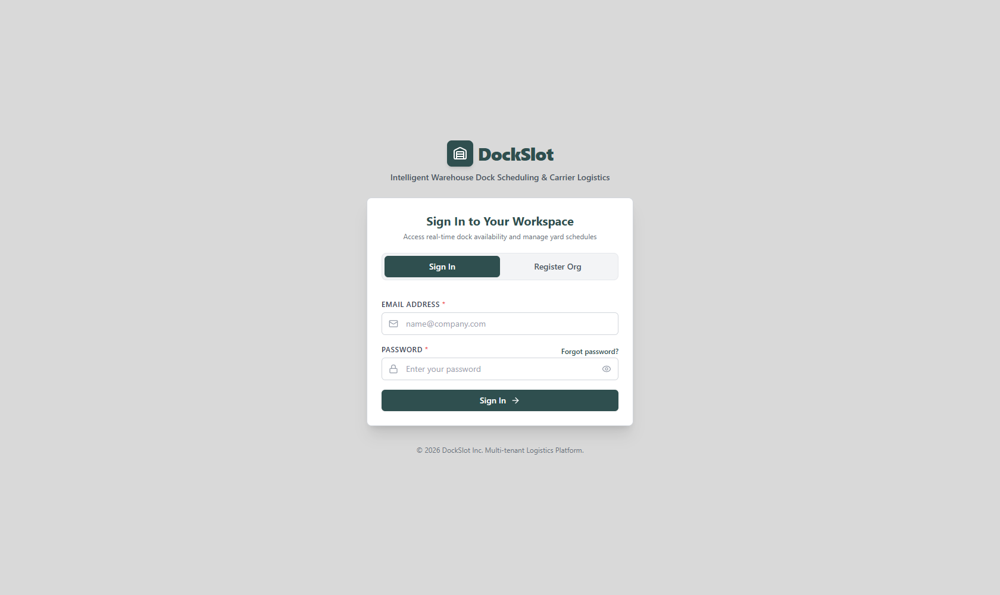
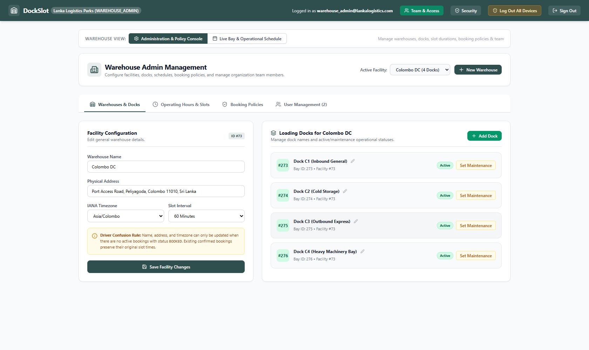
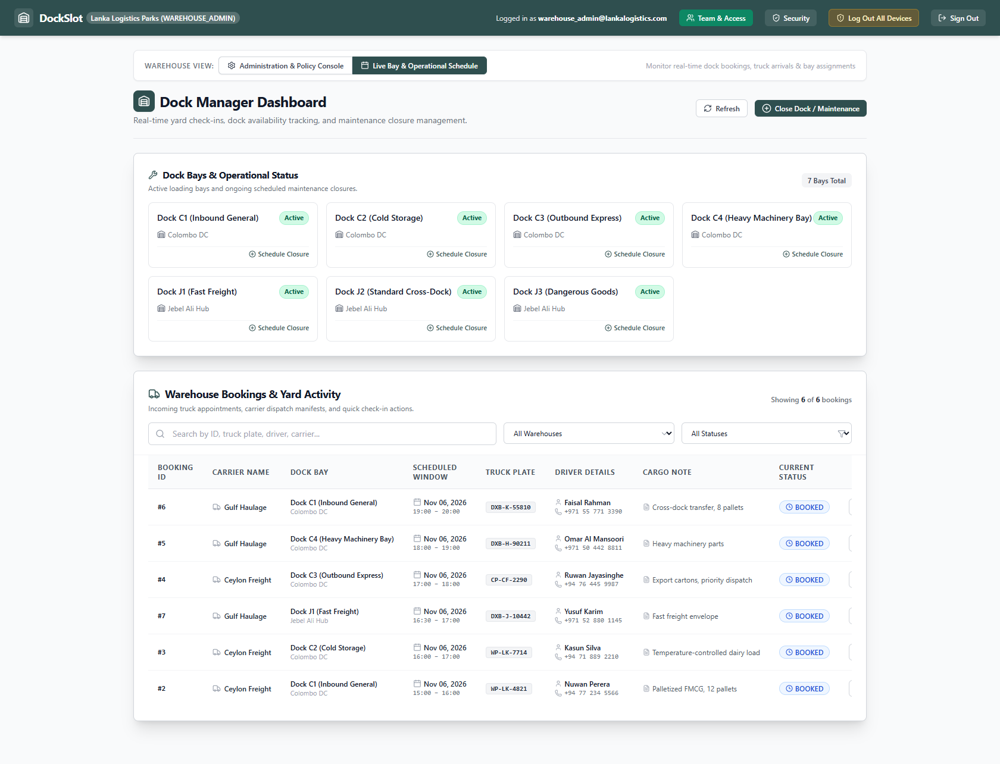
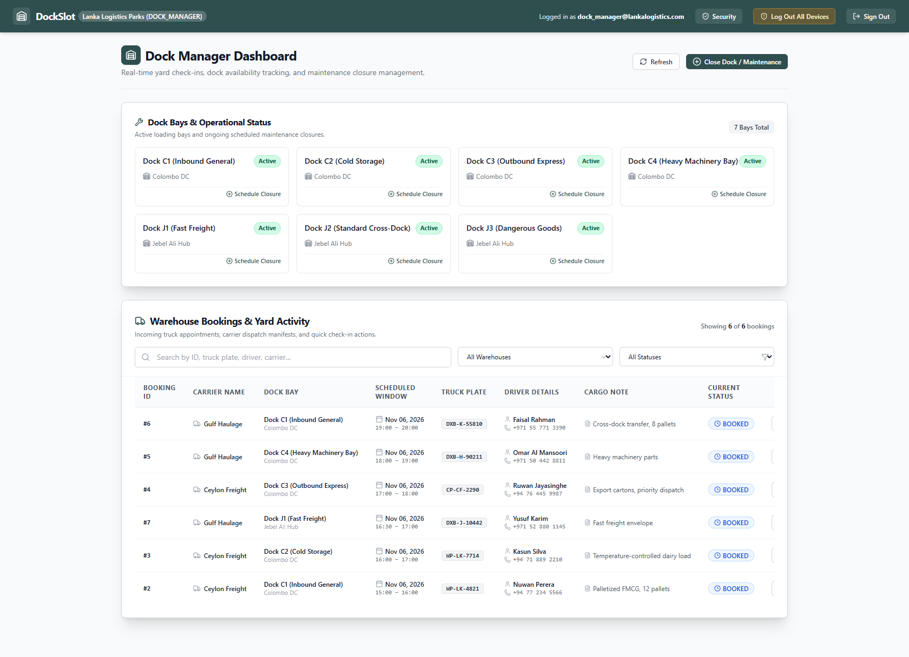
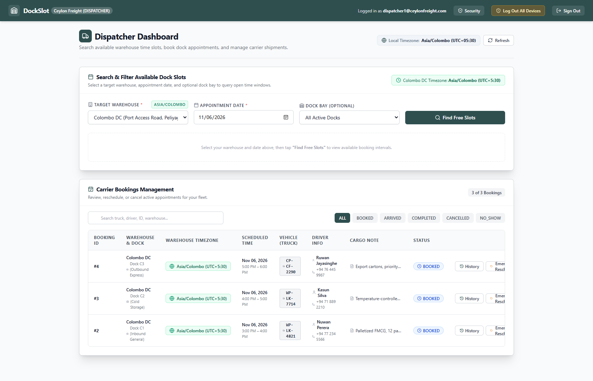
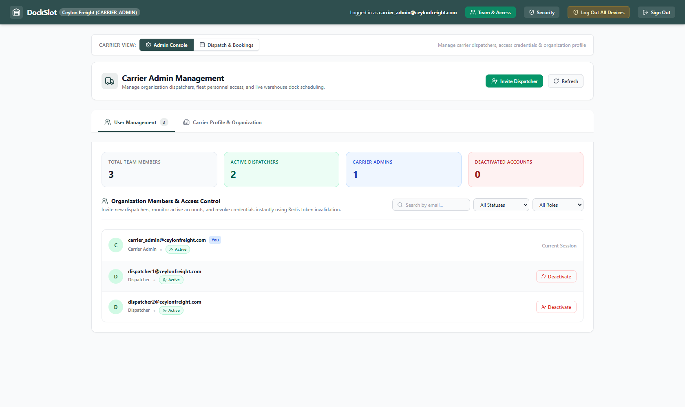
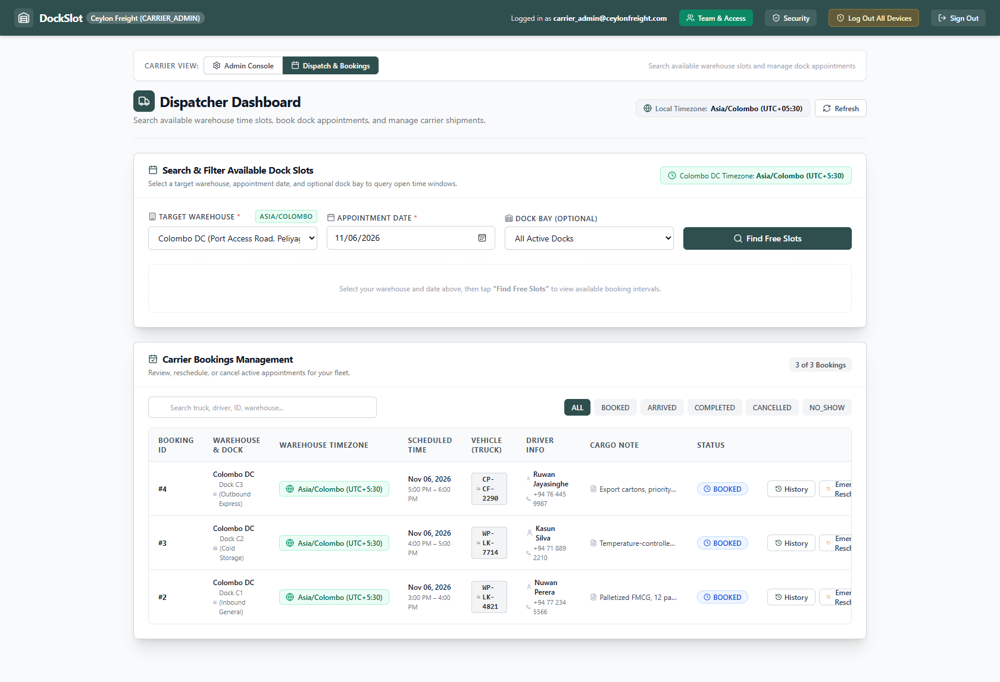

Multi-tenant dock slot booking platform for warehouse operators and carriers.

## Engineering principles

DockSlot is structured as a production-shaped reference implementation, not a
demo-only prototype. The same boundaries, configuration rules, and verification
steps are used locally, in tests, and in the containerized stack.

### Clean by construction

- The backend follows route → controller → service → repository boundaries, with
  Prisma as the only database access layer.
- Configuration is centralized and validated at startup; secrets, CORS, cookie
  flags, and TOTP keys fail fast instead of degrading silently.
- `backend/src/config/env.ts` loads `.env` exactly once, avoiding duplicate
  environment parsing across modules and entry points.
- TypeScript is used end to end, with typed API contracts and the `@/*` path
  alias shared by TypeScript, Vite, and Vitest.
- Shared frontend primitives centralize booking status rendering, filtering,
  timezone/date handling, and role routing instead of duplicating them per
  dashboard.
- Refactors remove unused code and consolidate duplicated UI/service logic behind
  shared utilities.

### Scalable by design

- The HTTP API is designed to be stateless and can run behind a load balancer;
  proxy trust is configurable so rate limiting and request logs see the real
  client IP.
- Redis backs distributed rate limiting and the `tokenVersion` revocation cache,
  while MySQL remains the source of truth. The in-memory Redis fallback is
  disabled in production.
- Rotating refresh sessions support server-side revocation, absolute and idle
  family lifetimes, and replay detection.
- The transactional outbox worker moves webhook delivery off the request path,
  and graceful shutdown drains in-flight work before exit.
- The frontend lazy-loads dashboards, recovery pages, and modals behind
  accessible fallbacks, with stable vendor chunks keeping the initial shell
  small.
- Docker Compose provides a reproducible local stack with health checks, schema
  sync, and seeded demo data.

### Industry standards

- Authentication follows OWASP ASVS and OWASP Cheat Sheet guidance plus NIST
  SP 800-63B patterns: bcrypt password hashes, short-lived access JWTs, HttpOnly
  rotating refresh cookies, optional TOTP MFA with AES-256-GCM, rate limiting,
  account lockout, strict CSP/HSTS, a credentialed CORS allowlist, and `no-store`
  auth responses.
- The API is documented with OpenAPI 3.0/Swagger and uses consistent error
  handling and security headers.
- UI interactions use semantic controls, keyboard/focus management, dialog
  accessibility helpers, and responsive layouts.
- Backend tests boot the real Express app against MySQL; frontend tests use
  Vitest and Testing Library for shared utilities, services, and UI primitives.
- Type checking, linting, formatting, Tailwind class validation, tests, and
  production builds are treated as required quality gates.

The authentication section below documents the security controls in detail.
These alignments are not a formal certification.

## UI

Screenshots captured from the running app with the seeded demo data. See
[`ui-iterations/README.md`](ui-iterations/README.md) for the iteration log.

ui-iterations/UI-flow.png

### Auth




### Warehouse Admin Dashboard




### Dock Manager Dashboard



### Dispatcher Dashboard



### Carrier Admin Dashboard




## Running the project

Docker Compose requires two independent JWT secrets and a 32-byte TOTP
encryption key (no defaults are committed). Generate them once and export them,
or put them in a root `.env` file:

```sh
node -e "console.log(require('crypto').randomBytes(32).toString('base64url'))"
node -e "console.log(require('crypto').randomBytes(32).toString('base64'))"
```

```sh
export JWT_ACCESS_SECRET="<first generated value>"
export JWT_REFRESH_SECRET="<second generated value>"
export TOTP_ENCRYPTION_KEY="<third generated value>"
docker compose up --build
```

For a non-Docker backend, copy `backend/.env.example` to `backend/.env` and fill
in the same values. Production requires both JWT secrets (at least 32 characters
each, and different from each other) and a base64/hex TOTP key that decodes to
exactly 32 bytes.

The backend container applies the schema and loads the demo data on boot
(`prisma db push` + `prisma db seed`). See `docker-compose.yml` for the services
and host port overrides.

The backend loads `backend/.env` exactly once through
`backend/src/config/env.ts`. Config modules and entry points import that loader
instead of calling `dotenv.config()` directly, so startup does not parse or
report the same environment multiple times.

### Frontend

```sh
cd frontend
cp .env.example .env.local   # Windows: copy .env.example .env.local
npm ci
npm run dev
```

`VITE_API_URL` is the absolute API base URL and must include the API path
(`http://localhost:5000/api` in development). Production builds require an
explicit HTTPS value; `npm run build` fails fast if it is missing or insecure.
`vite.config.ts` also applies CSP, HSTS (preview/production), frame denial,
`nosniff`, `Referrer-Policy: no-referrer`, and a restrictive
`Permissions-Policy` to the dev and preview servers. Production builds generate
`dist/_headers` for Cloudflare Workers static assets from the same validated API
origin, and `frontend/wrangler.jsonc` enables the SPA fallback with
`not_found_handling: "single-page-application"`. A different static host or
reverse proxy must apply equivalent headers to the built `dist/` files. It
should also avoid logging query strings for
`/reset-password` and `/accept-invite` (or redact `token=`); the SPA scrubs the
token immediately, but the initial document request still reaches the static
host.

### Free demo deployment

[`DEPLOYMENT.md`](DEPLOYMENT.md) documents a zero-cost demo topology:
Cloudflare Workers static assets for the SPA, Render Free for the API, TiDB
Cloud Starter for MySQL, and Render Key Value for Redis. The backend keeps the
outbox worker in-process, and the mock carrier can run in the same container.

Production email is provider-agnostic. Set `EMAIL_PROVIDER=smtp` for an
authenticated SMTP relay, or `EMAIL_PROVIDER=resend` / `EMAIL_PROVIDER=brevo` to
use HTTPS APIs. The HTTPS providers are required on hosts that block outbound
SMTP, such as Render free web services. Seeded demo accounts are pre-verified,
so login works even when email delivery is disabled.

## Frontend architecture

The SPA is split so the initial shell stays small and shared domain behavior is
implemented once:

- `@/*` maps to `frontend/src/*` in TypeScript, Vite, and Vitest.
- Dashboards, password-recovery pages, and team/security modals are lazy-loaded
  behind accessible Suspense fallbacks (`PageLoadingFallback` / `LoadingState`).
- `frontend/vite.config.ts` groups React, Axios, date libraries, Lucide icons,
  and remaining dependencies into stable vendor chunks.
- Booking status metadata and rendering live in
  `frontend/src/utils/bookingStatus.ts` and
  `frontend/src/components/BookingStatusBadge.tsx`; the Dispatcher and Dock
  Manager dashboards share the same badge and filter options.
- Booking status, warehouse, and text-search filtering lives in
  `frontend/src/utils/bookingFilters.ts`.
- Timezone, date-key, and slot-window helpers live in
  `frontend/src/utils/formatters.ts` and `frontend/src/utils/timezones.ts`.
- Dashboard role routing and role capability helpers live in
  `frontend/src/utils/dashboardView.ts`.

## Seeded demo accounts

All seeded accounts are pre-verified and share the same password: `12345678`

| Email | Password | Role | Organization |
| --- | --- | --- | --- |
| `warehouse_admin@lankalogistics.com` | `12345678` | Warehouse Admin | Lanka Logistics Parks |
| `dock_manager@lankalogistics.com` | `12345678` | Dock Manager | Lanka Logistics Parks |
| `warehouse_admin@maasdistribution.com` | `12345678` | Warehouse Admin | Maas Distribution |
| `dock_manager@maasdistribution.com` | `12345678` | Dock Manager | Maas Distribution |
| `carrier_admin@ceylonfreight.com` | `12345678` | Carrier Admin | Ceylon Freight |
| `dispatcher1@ceylonfreight.com` | `12345678` | Dispatcher | Ceylon Freight |
| `dispatcher2@ceylonfreight.com` | `12345678` | Dispatcher | Ceylon Freight |
| `carrier_admin@gulfhaulage.com` | `12345678` | Carrier Admin | Gulf Haulage |
| `dispatcher@gulfhaulage.com` | `12345678` | Dispatcher | Gulf Haulage |

> The seed is destructive: it clears and recreates the demo data on every run.
> Use `docker compose down -v` to start from a clean database.

## Seeded warehouses

| Warehouse | Operator | Timezone | Operating hours | Slot length | Docks |
| --- | --- | --- | --- | --- | --- |
| Colombo DC | Lanka Logistics Parks | `Asia/Colombo` | Mon–Sat 06:00–22:00 | 60 min | 4 |
| Jebel Ali Hub | Lanka Logistics Parks | `Asia/Dubai` | Every day 07:00–19:00 | 30 min | 3 |
| Rotterdam Port DC | Maas Distribution | `Europe/Amsterdam` | 24/7 | 60 min | 6 |

## Authentication model

DockSlot uses a defense-in-depth, industry-standard authentication design:
short-lived access tokens, rotating refresh sessions, server-side revocation,
adaptive password hashing, optional TOTP MFA, and layered abuse controls. The
implementation follows patterns recommended by OWASP (ASVS, Authentication,
Session Management, and Password Storage Cheat Sheets) and NIST SP 800-63B.
This is an alignment statement, not a formal certification.

### Standards alignment at a glance

| Area | Control |
| --- | --- |
| Password storage | bcrypt hashes with a configurable work factor (`BCRYPT_SALT_ROUNDS`); plaintext passwords are never stored. |
| Password quality | 8–128 characters, common-password rejection, and an optional HIBP k-anonymity breach check. |
| Access tokens | 15-minute signed JWTs kept in browser memory only—never `localStorage`, `sessionStorage`, or a JS-readable cookie. |
| Refresh sessions | HttpOnly, `SameSite=Lax` (configurable), and `Secure` in production; scoped to `/api/auth` with a sliding 7-day lifetime, 30-day absolute cap, optional idle timeout, rotation, and reuse detection. |
| Session revocation | Durable `tokenVersion` plus server-side refresh-session revocation; Redis cache entries are deleted immediately. |
| Token storage | Refresh sessions store only the `jti`; reset and email-verification tokens are stored as SHA-256 hashes. |
| MFA | TOTP with AES-256-GCM encrypted secrets at rest and rate-limited verification. |
| Abuse prevention | Per-route/account/IP auth limits, failed-login limits, per-family refresh limits, password-reset limits, 2FA limits, and per-account lockout. |
| Browser hardening | Helmet security headers, a strict CSP, production HSTS, `no-store` auth responses, and a credentialed CORS allowlist. |

These controls assume TLS termination, strong independent secrets, and a trusted
reverse proxy in production. The table documents the application’s security
posture, not a formal compliance certification.

### Implementation details

- **Access tokens** are short-lived (15 minutes) and returned in the JSON
  response. The browser client keeps them in memory only; they are never written
  to `localStorage`, `sessionStorage`, or a JS-readable cookie.
- **Refresh tokens** are 7-day JWTs delivered in an HttpOnly,
  `SameSite=Lax` (configurable) cookie scoped to `/api/auth`; `Secure` is
  enabled in production (or when `COOKIE_SECURE=true`). Each token is backed by
  a row in `refresh_sessions`.
- **Rotation:** every successful `/auth/refresh` creates a new `jti`, marks the
  previous session `ROTATED`, and links it with `replacedByJti`. A short grace
  window lets concurrent tabs retry the same cookie; replay outside that window
  revokes the entire token family.
- **Absolute family lifetime:** sliding rotation cannot exceed
  `REFRESH_SESSION_ABSOLUTE_TTL` (default 30 days) from the original login.
  `REFRESH_SESSION_IDLE_TTL` optionally revokes a family when it has not been
  refreshed within the configured window.
- **Revocation:** `/auth/logout` revokes only the current refresh session.
  `/auth/logout-all`, password change, password reset, and account deactivation
  increment the durable `users.tokenVersion`, revoke every refresh session, and
  explicitly delete the Redis `tokenVersion` cache entry, so old credentials
  stay dead even after a Redis flush or reactivation.
- **Redis** caches `tokenVersion` for `TOKEN_VERSION_CACHE_TTL_SECONDS` (default
  60) but MySQL is the source of truth. Revocation paths delete the cache key
  instead of waiting for that TTL to expire.
- **Security headers:** Helmet applies a strict CSP for API responses,
  `X-Content-Type-Options: nosniff`, `X-Frame-Options: DENY`,
  `Referrer-Policy: no-referrer`, and a restrictive `Permissions-Policy`. HSTS
  (one year, includeSubDomains, preload) is enabled automatically when
  `NODE_ENV=production`. Swagger UI gets a separately scoped, relaxed CSP.
- **Caching:** every `/api/auth` response is sent with `Cache-Control: no-store`
  so access tokens and identity data cannot be cached by browsers or proxies.
- **Credential abuse controls:** the credential entry routes (`/login`,
  `/register`, `/forgot-password`, `/reset-password`, `/resend-verification`)
  carry a dedicated `RATE_LIMIT_AUTH_MAX` limiter (default 10/min) keyed by route
  + account/token + IP. Failed logins additionally have their own email+IP limiter
  (`RATE_LIMIT_LOGIN_MAX` / `RATE_LIMIT_LOGIN_WINDOW_MS`, default 10 per 15
  minutes), and refresh attempts are capped per token family + IP
  (`RATE_LIMIT_REFRESH_MAX`, default 30/min). The 2FA limiter remains scoped
  per route and IP. Forgot-password has its own email+IP limiter and a one-hour
  reset-token lifetime. The existing per-account lockout remains as a last line
  of defense; the limiters above reduce how often an attacker can reach it.
- **Password policy:** new/changed/reset passwords must be 8–128 characters.
  Common passwords are rejected. Set `PASSWORD_BREACH_CHECK_ENABLED=true` to add
  a k-anonymity HaveIBeenPwned check; the check fails open if HIBP is
  unavailable. The seeded demo passwords (`12345678`) are legacy demo
  credentials only; they cannot be used to register or change a password.
- **Credential storage:** passwords are bcrypt hashes, refresh sessions store
  only the token `jti` (not the token), and password-reset and email-verification
  tokens are stored as SHA-256 hashes. The raw reset and verification tokens
  exist only in the email link.
- **Email verification:** registration and resend links are valid for 24 hours.
  Expired tokens are rejected and consumed so they cannot be retried. Links
  issued before this change have no recorded expiry and are treated as expired;
  request a new verification email.
- **2FA secret encryption:** TOTP secrets are encrypted at rest with
  AES-256-GCM using `TOTP_ENCRYPTION_KEY` and stored as
  `iv:authTag:ciphertext`. The key must decode to 32 bytes. Existing plaintext
  secrets are re-encrypted lazily on first use; operators can also run the
  one-time `npm run migrate:totp` migration in `backend/` (or
  `npm run migrate:totp:prod` from a compiled deployment). In Docker:
  `docker compose exec backend node dist/scripts/migrate-totp-secrets.js`.

Relevant environment variables:

| Variable | Default | Purpose |
| --- | --- | --- |
| `JWT_ACCESS_SECRET` | required in production | Independent access-token signing secret |
| `JWT_REFRESH_SECRET` | required in production | Independent refresh-token signing secret |
| `JWT_EXPIRES_IN` | `15m` | Access-token lifetime |
| `JWT_REFRESH_EXPIRES_IN` | `7d` | Sliding refresh-token lifetime |
| `REFRESH_SESSION_ABSOLUTE_TTL` | `30d` | Maximum lifetime of a login family |
| `REFRESH_SESSION_IDLE_TTL` | unset | Optional inactivity timeout for a login family |
| `REFRESH_REUSE_GRACE_SECONDS` | `30` | Concurrent-tab rotation grace window |
| `COOKIE_SECURE` | `true` in production | Override the refresh cookie’s `Secure` flag |
| `COOKIE_SAME_SITE` | `lax` | Refresh cookie `SameSite` policy |
| `BCRYPT_SALT_ROUNDS` | `10` | bcrypt work factor |
| `MAX_FAILED_LOGIN_ATTEMPTS` | `5` | Failed attempts before account lockout |
| `LOGIN_LOCKOUT_DURATION_MINUTES` | `15` | Account lockout duration |
| `TOTP_ENCRYPTION_KEY` | required in production | 32-byte AES-256-GCM key for TOTP secrets |
| `TOKEN_VERSION_CACHE_TTL_SECONDS` | `60` | Redis cache TTL for tokenVersion |
| `RATE_LIMIT_AUTH_MAX` | `10` | Auth requests per route/account/token+IP per window |
| `RATE_LIMIT_REFRESH_MAX` | `30` | Refresh requests per token family+IP per window |
| `RATE_LIMIT_2FA_MAX` | `5` | 2FA code submissions per route+IP per window |
| `RATE_LIMIT_LOGIN_WINDOW_MS` | `900000` | Failed-login limiter window |
| `RATE_LIMIT_LOGIN_MAX` | `10` | Failed logins per email+IP per window |
| `RATE_LIMIT_PASSWORD_RESET_WINDOW_MS` | `3600000` | Forgot-password limiter window |
| `RATE_LIMIT_PASSWORD_RESET_MAX` | `5` | Forgot-password requests per email+IP per window |
| `PASSWORD_BREACH_CHECK_ENABLED` | `false` | Optional HIBP k-anonymity password check |

Generate a TOTP key with
`node -e "console.log(require('crypto').randomBytes(32).toString('base64'))"`.
Docker Compose requires `TOTP_ENCRYPTION_KEY` alongside the JWT secrets.

## Running tests

### Backend

The backend suite is integration-level: it boots the real Express app and
exercises a real MySQL database through Prisma — nothing is mocked. One command
applies the schema and runs **all** backend tests against that database:

```sh
cd backend
npm run test:db
```

`test:db` runs `prisma db push` (to sync the schema with `DATABASE_URL`) and then
the full Vitest suite.

If the schema is already applied and you only want to re-run the tests:

```sh
cd backend
npm test
```

Prerequisites: installed dependencies (`npm ci`), a generated Prisma client
(`npx prisma generate`), and a reachable MySQL — the same `DATABASE_URL` the app
uses (see `backend/.env`). The tests are stateful, so point `DATABASE_URL` at a
dedicated test database for deterministic results; the bundled stack's database
can be reset with `docker compose down -v`.

### Frontend

The frontend suite uses Vitest and Testing Library and covers the API client,
shared booking/status/timezone helpers, dashboard services, and UI primitives:

```sh
cd frontend
npm test
```

Additional validation commands:

```sh
npm run typecheck
npm run lint
npm run format:check
npm run check:tailwind
npm run build
```

`npm run build` requires the same explicit HTTPS `VITE_API_URL` described in the
Frontend section above.

## Final System Architecture diagram


