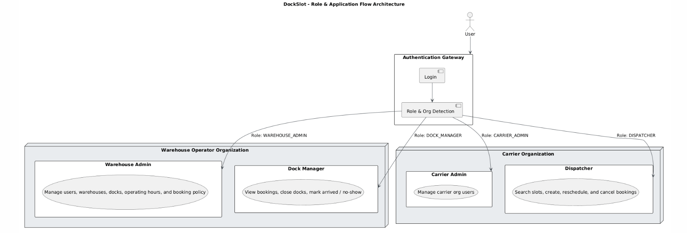
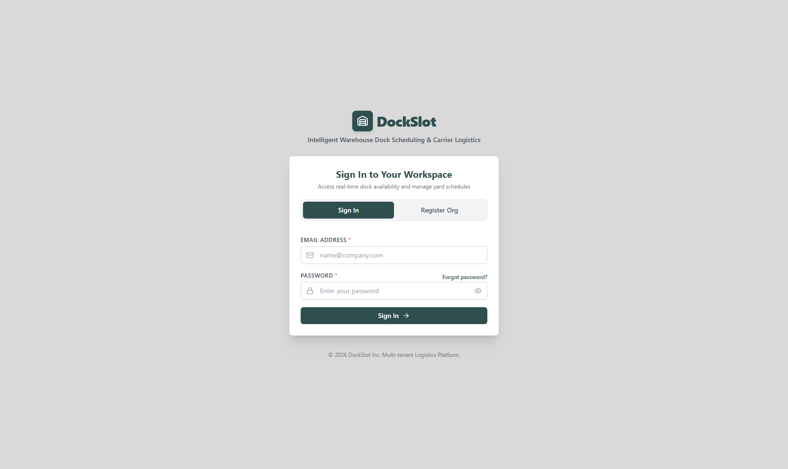
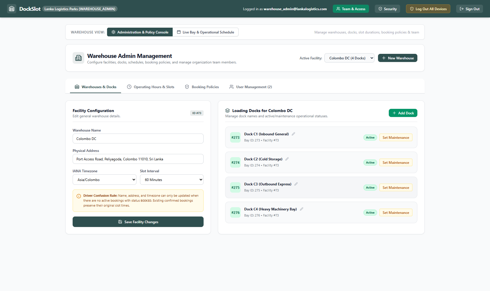
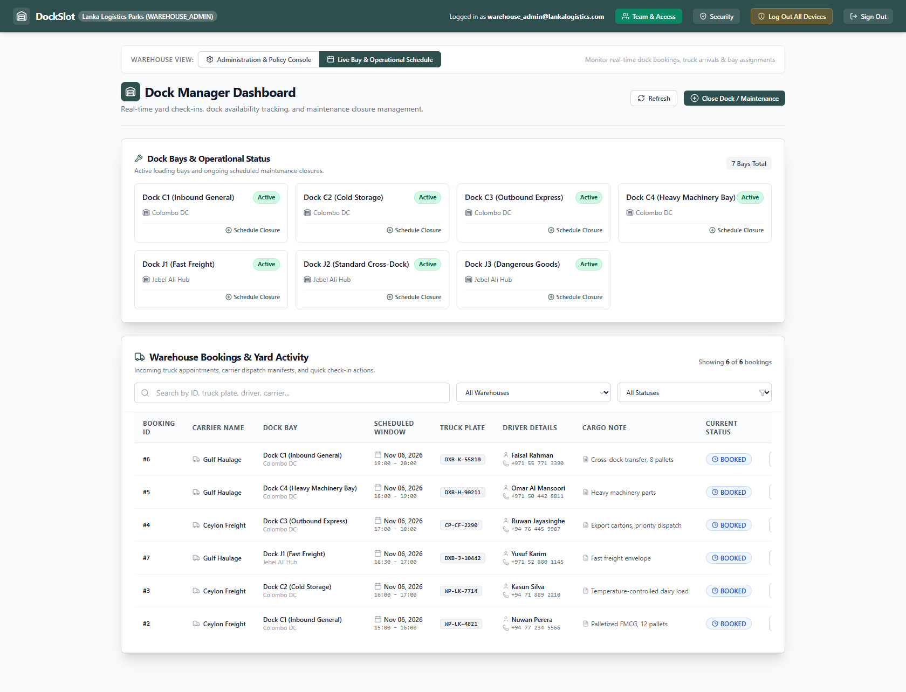
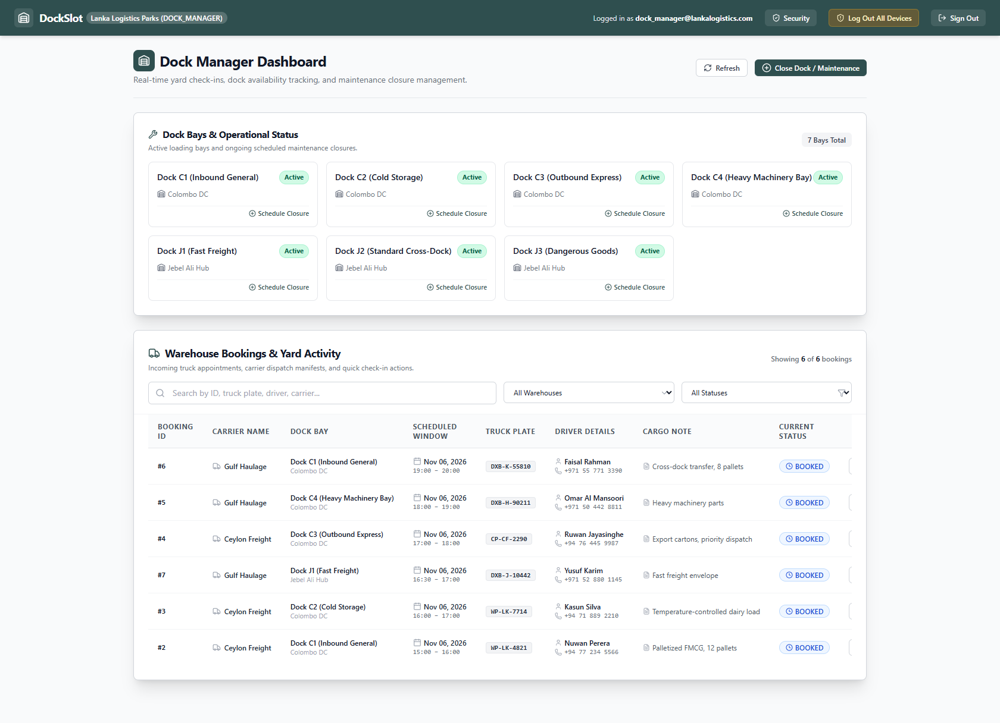
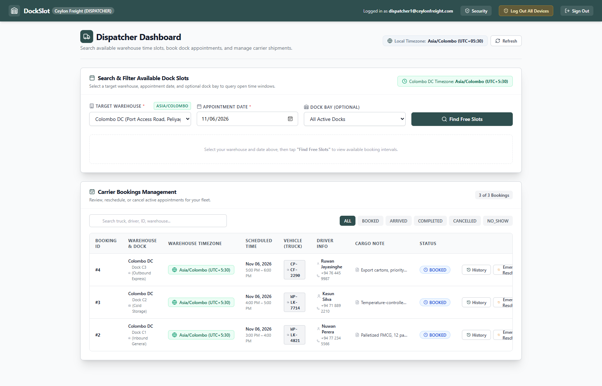
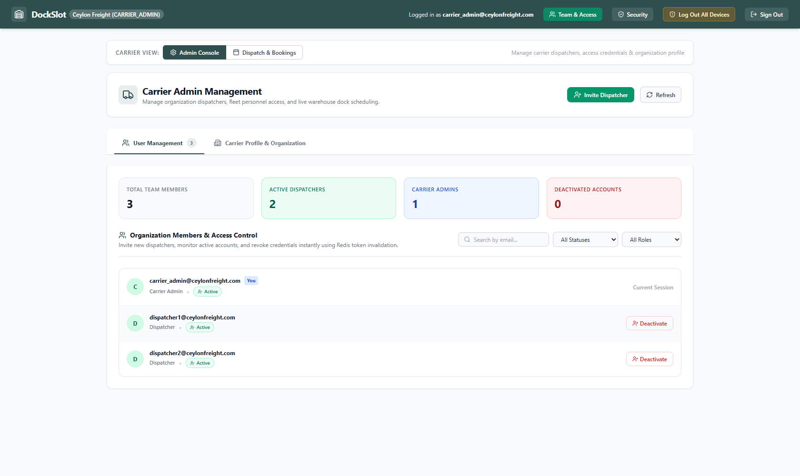
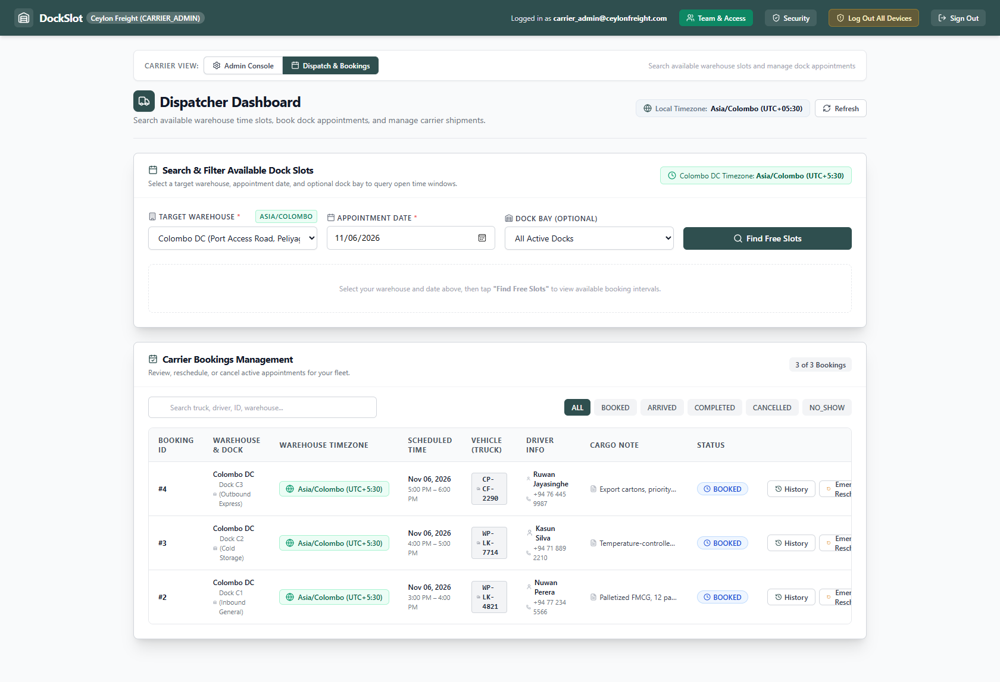

# DockSlot

Multi-tenant dock slot booking platform for warehouse operators and carriers.

## UI

Screenshots captured from the running app with the seeded demo data. See
[`ui-iterations/README.md`](ui-iterations/README.md) for the iteration log.



### Auth



### Warehouse Admin Dashboard




### Dock Manager Dashboard



### Dispatcher Dashboard



### Carrier Admin Dashboard




## Running the project

Docker Compose requires two independent JWT secrets and a 32-byte TOTP
encryption key (no defaults are committed). Generate them once and export them,
or put them in a root `.env` file:

```sh
node -e "console.log(require('crypto').randomBytes(32).toString('base64url'))"
node -e "console.log(require('crypto').randomBytes(32).toString('base64'))"
```

```sh
export JWT_ACCESS_SECRET="<first generated value>"
export JWT_REFRESH_SECRET="<second generated value>"
export TOTP_ENCRYPTION_KEY="<third generated value>"
docker compose up --build
```

For a non-Docker backend, copy `backend/.env.example` to `backend/.env` and fill
in the same values. Production requires both JWT secrets (at least 32 characters
each, and different from each other) and a base64/hex TOTP key that decodes to
exactly 32 bytes.

The backend container applies the schema and loads the demo data on boot
(`prisma db push` + `prisma db seed`). See `docker-compose.yml` for the services
and host port overrides.

## Seeded demo accounts

All seeded accounts are pre-verified and share the same password: `12345678`

| Email | Password | Role | Organization |
| --- | --- | --- | --- |
| `warehouse_admin@lankalogistics.com` | `12345678` | Warehouse Admin | Lanka Logistics Parks |
| `dock_manager@lankalogistics.com` | `12345678` | Dock Manager | Lanka Logistics Parks |
| `warehouse_admin@maasdistribution.com` | `12345678` | Warehouse Admin | Maas Distribution |
| `dock_manager@maasdistribution.com` | `12345678` | Dock Manager | Maas Distribution |
| `carrier_admin@ceylonfreight.com` | `12345678` | Carrier Admin | Ceylon Freight |
| `dispatcher1@ceylonfreight.com` | `12345678` | Dispatcher | Ceylon Freight |
| `dispatcher2@ceylonfreight.com` | `12345678` | Dispatcher | Ceylon Freight |
| `carrier_admin@gulfhaulage.com` | `12345678` | Carrier Admin | Gulf Haulage |
| `dispatcher@gulfhaulage.com` | `12345678` | Dispatcher | Gulf Haulage |

> The seed is destructive: it clears and recreates the demo data on every run.
> Use `docker compose down -v` to start from a clean database.

## Seeded warehouses

| Warehouse | Operator | Timezone | Operating hours | Slot length | Docks |
| --- | --- | --- | --- | --- | --- |
| Colombo DC | Lanka Logistics Parks | `Asia/Colombo` | Mon–Sat 06:00–22:00 | 60 min | 4 |
| Jebel Ali Hub | Lanka Logistics Parks | `Asia/Dubai` | Every day 07:00–19:00 | 30 min | 3 |
| Rotterdam Port DC | Maas Distribution | `Europe/Amsterdam` | 24/7 | 60 min | 6 |

## Authentication model

- **Access tokens** are short-lived (15 minutes) and returned in the JSON
  response. The browser client keeps them in memory only; they are never written
  to `localStorage`, `sessionStorage`, or a JS-readable cookie.
- **Refresh tokens** are 7-day JWTs delivered in an HttpOnly, SameSite cookie
  scoped to `/api/auth`. Each token is backed by a row in `refresh_sessions`.
- **Rotation:** every successful `/auth/refresh` creates a new `jti`, marks the
  previous session `ROTATED`, and links it with `replacedByJti`. A short grace
  window lets concurrent tabs retry the same cookie; replay outside that window
  revokes the entire token family.
- **Absolute family lifetime:** sliding rotation cannot exceed
  `REFRESH_SESSION_ABSOLUTE_TTL` (default 30 days) from the original login.
  `REFRESH_SESSION_IDLE_TTL` optionally revokes a family when it has not been
  refreshed within the configured window.
- **Revocation:** `/auth/logout` revokes only the current refresh session.
  `/auth/logout-all`, password change, password reset, and account deactivation
  increment the durable `users.tokenVersion`, revoke every refresh session, and
  explicitly delete the Redis `tokenVersion` cache entry, so old credentials
  stay dead even after a Redis flush or reactivation.
- **Redis** caches `tokenVersion` for `TOKEN_VERSION_CACHE_TTL_SECONDS` (default
  60) but MySQL is the source of truth. Revocation paths delete the cache key
  instead of waiting for that TTL to expire.
- **Security headers:** Helmet applies a strict CSP for API responses,
  `X-Content-Type-Options: nosniff`, `X-Frame-Options: DENY`,
  `Referrer-Policy: no-referrer`, and a restrictive `Permissions-Policy`. HSTS
  (one year, includeSubDomains, preload) is enabled automatically when
  `NODE_ENV=production`. Swagger UI gets a separately scoped, relaxed CSP.
- **Caching:** every `/api/auth` response is sent with `Cache-Control: no-store`
  so access tokens and identity data cannot be cached by browsers or proxies.
- **Credential abuse controls:** failed logins are limited per normalized email +
  IP (`RATE_LIMIT_LOGIN_MAX` / `RATE_LIMIT_LOGIN_WINDOW_MS`, default 10 per 15
  minutes), on top of the per-account lockout. Forgot-password has its own
  email+IP limiter and a one-hour reset-token lifetime.
- **Password policy:** new/changed/reset passwords must be 8–128 characters.
  Common passwords are rejected. Set `PASSWORD_BREACH_CHECK_ENABLED=true` to add
  a k-anonymity HaveIBeenPwned check; the check fails open if HIBP is
  unavailable. The seeded demo passwords (`12345678`) are legacy demo
  credentials only; they cannot be used to register or change a password.
- **Credential storage:** passwords are bcrypt hashes, refresh sessions store
  only the token `jti` (not the token), and password-reset and email-verification
  tokens are stored as SHA-256 hashes. The raw reset and verification tokens
  exist only in the email link.
- **Email verification:** registration and resend links are valid for 24 hours.
  Expired tokens are rejected and consumed so they cannot be retried. Links
  issued before this change have no recorded expiry and are treated as expired;
  request a new verification email.
- **2FA secret encryption:** TOTP secrets are encrypted at rest with
  AES-256-GCM using `TOTP_ENCRYPTION_KEY` and stored as
  `iv:authTag:ciphertext`. The key must decode to 32 bytes. Existing plaintext
  secrets are re-encrypted lazily on first use; operators can also run the
  one-time `npm run migrate:totp` migration in `backend/` (or
  `npm run migrate:totp:prod` from a compiled deployment). In Docker:
  `docker compose exec backend node dist/scripts/migrate-totp-secrets.js`.

Relevant environment variables:

| Variable | Default | Purpose |
| --- | --- | --- |
| `JWT_EXPIRES_IN` | `15m` | Access-token lifetime |
| `JWT_REFRESH_EXPIRES_IN` | `7d` | Sliding refresh-token lifetime |
| `REFRESH_SESSION_ABSOLUTE_TTL` | `30d` | Maximum lifetime of a login family |
| `REFRESH_SESSION_IDLE_TTL` | unset | Optional inactivity timeout for a login family |
| `REFRESH_REUSE_GRACE_SECONDS` | `30` | Concurrent-tab rotation grace window |
| `TOTP_ENCRYPTION_KEY` | required in production | 32-byte AES-256-GCM key for TOTP secrets |
| `TOKEN_VERSION_CACHE_TTL_SECONDS` | `60` | Redis cache TTL for tokenVersion |
| `RATE_LIMIT_LOGIN_WINDOW_MS` | `900000` | Failed-login limiter window |
| `RATE_LIMIT_LOGIN_MAX` | `10` | Failed logins per email+IP per window |
| `RATE_LIMIT_PASSWORD_RESET_WINDOW_MS` | `3600000` | Forgot-password limiter window |
| `RATE_LIMIT_PASSWORD_RESET_MAX` | `5` | Forgot-password requests per email+IP per window |
| `PASSWORD_BREACH_CHECK_ENABLED` | `false` | Optional HIBP k-anonymity password check |

Generate a TOTP key with
`node -e "console.log(require('crypto').randomBytes(32).toString('base64'))"`.
Docker Compose requires `TOTP_ENCRYPTION_KEY` alongside the JWT secrets.

## Running tests

The suite is integration-level: it boots the real Express app and exercises a
real MySQL database through Prisma — nothing is mocked. One command applies the
schema and runs **all** tests against that database:

```sh
cd backend
npm run test:db
```

`test:db` runs `prisma db push` (to sync the schema with `DATABASE_URL`) and then
the full Vitest suite.

If the schema is already applied and you only want to re-run the tests:

```sh
cd backend
npm test
```

Prerequisites: installed dependencies (`npm ci`), a generated Prisma client
(`npx prisma generate`), and a reachable MySQL — the same `DATABASE_URL` the app
uses (see `backend/.env`). The tests are stateful, so point `DATABASE_URL` at a
dedicated test database for deterministic results; the bundled stack's database
can be reset with `docker compose down -v`.

## Final System Architecture diagram


