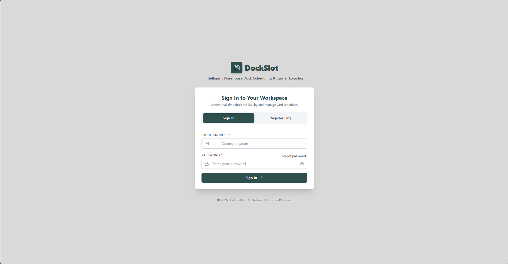
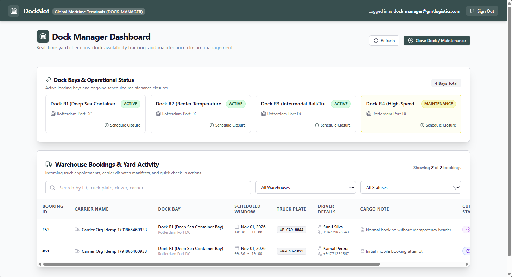
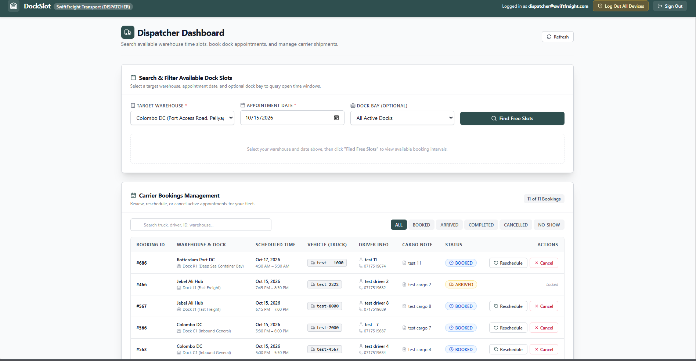
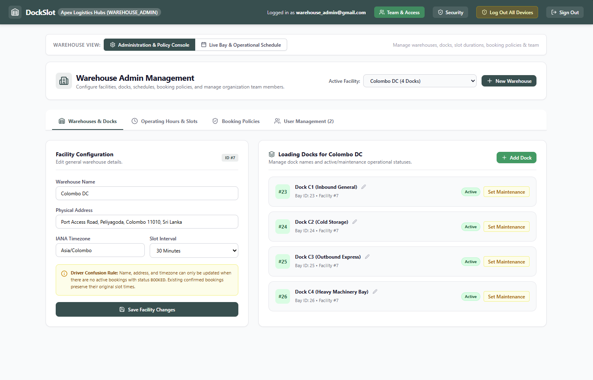
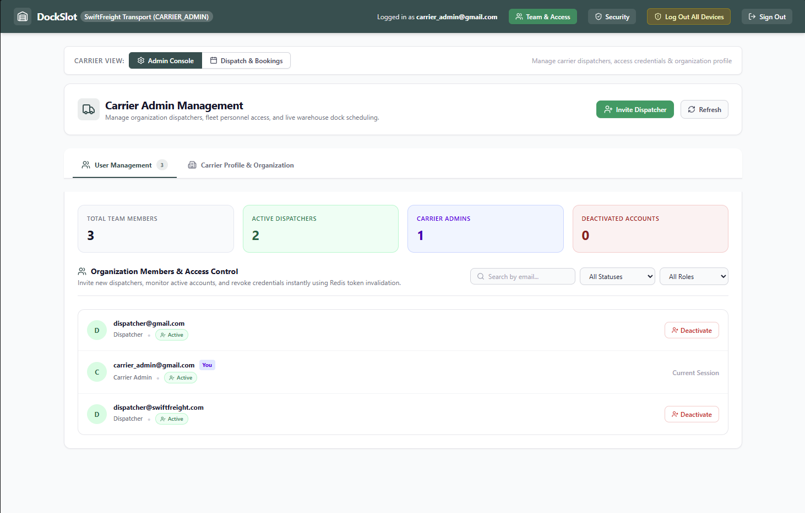

# UI Iteration Record & Notes

This record documents the evolution of the UI components, design decisions, and critical debugging steps encountered during development.

---

### 1. General Design & Theme Choice
* **Observation:** The AI's first UI iteration did not follow the exact color theme provided in the initial prompt, but it successfully met all structural and layout requirements. 
* **Decision:** Because the color palette chosen by the AI looked cleaner and fit the application better, I chose to stick with it for the rest of the project.
* **Screenshots:**

---

### 2. Authentication UI & Email Catcher
* **Implementation & Bug Fix:** The authentication screens were successfully implemented. However, an initial state synchronization bug involving `useEffect` and `useState` caused `activeTab` to display incorrectly. The AI agent caught and fixed this autonomously without my direct input.
* **Email Catcher Adjustment:** After running into issues with the Mailhog email catcher configuration, we switched to an alternative local email solution that worked seamlessly with zero drawbacks.

---

### 3. Dock Manager Dashboard & Prisma Stale Metadata Fix
* **UI Implementation:** The UI for the Dock Manager dashboard was implemented smoothly.
* **The Issue:** A tricky backend bug surfaced when calling `prisma.dockClosure.create()`. The Prisma Client cached in `node_modules/.prisma/client` still held stale schema metadata referencing `dockManagerId` from an earlier generation, even though `schema.prisma` and the MySQL `dock_closures` table only expected `{ dockId, startTime, endTime, reason }`. This caused runtime crashes when trying to map the stale column to MySQL.
* **How the AI Fixed It:** 
  1. Stopped background processes holding the query engine DLL.
  2. Regenerated a clean Prisma client using `npx prisma generate` to match actual database columns.
  3. Verified that `warehouse.service.ts` and `warehouse.controller.ts` correctly create dock closures using only `{ dockId, startTime, endTime, reason }`.
  4. Restarted the backend server.
* **Validations Added:** Added robust front- and back-end validation to require a maintenance reason, prevent selecting past dates, and restrict booking status changes (Arrived / No-Show) so they can only be triggered *after* the scheduled start time has passed.
* **Screenshots:**

---

### 4. Dispatcher Dashboard
* **Implementation:** The Dispatcher dashboard UI and booking slot views were implemented cleanly without issues.
* **Screenshots:**

---

### 5. Warehouse Admin Dashboard
* **Implementation:** The Warehouse Admin dashboard was successfully built, allowing operators to manage warehouses, docks, and operating hours.
* **Screenshots:**

---

### 6. Carrier Admin Dashboard & Navigation Cleanup
* **Implementation:** The Carrier Admin dashboard was established for managing carrier users and organization details.
* **Refinement:** In the initial implementation, there were two separate dispatch and booking sections:
  1. A dedicated standalone dispatch/booking section.
  2. A duplicate dispatch/booking section embedded inside the admin console tabs.
* **The Fix:** Recognizing that the version inside the admin console tabs was redundant clutter, I instructed the AI to remove that specific section from `frontend/src/pages/CarrierAdminDashboard.tsx`.
* **Screenshots:**

